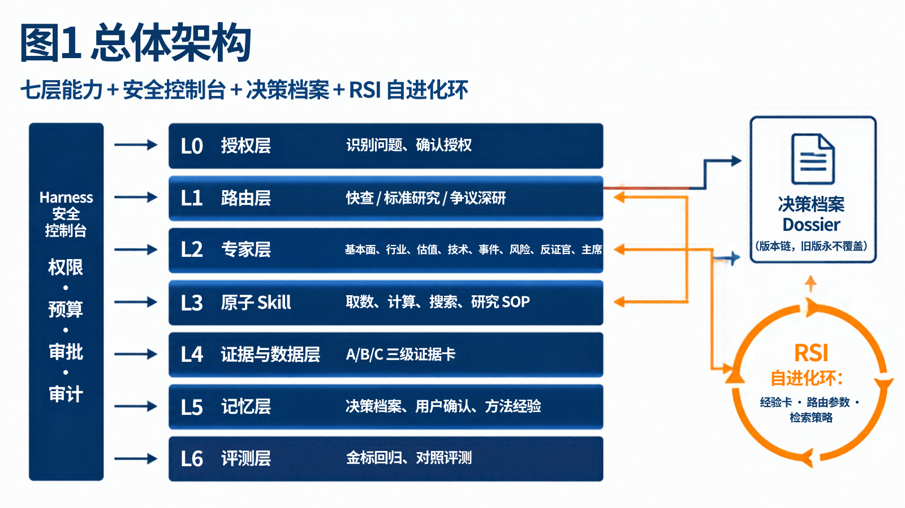
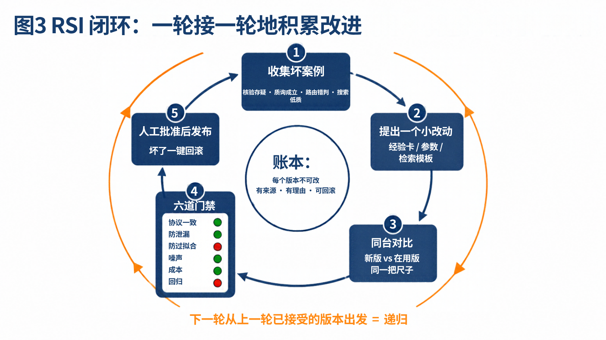
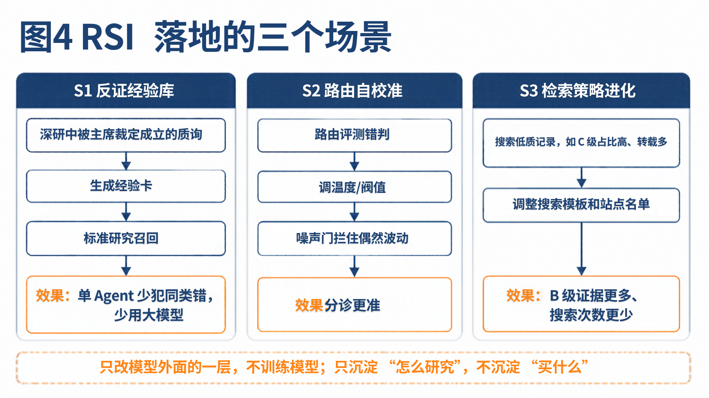
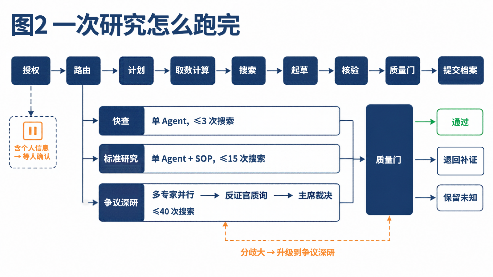

# 股票投资顾问 Agent

输入一个 股票研究问题，双轴路由选择流程：快查、标准研究（单 Agent + 业绩复核 SOP）或争议深研（多专家 + 反证官 + 主席）。
输出**可追溯、可复核**的研究底稿，写入带版本链的决策档案。

> 仅研究与模拟，不构成投资建议，不承诺收益，不执行任何交易。

## 架构一览

七层能力 + Harness 安全控制台 + 版本化决策档案 + RSI 自进化环：



## 快速开始

### 方式一：Docker 一键启动（推荐，Windows / macOS / Linux 通用）

前置：安装并启动 Docker Desktop（Windows 需开启 WSL2）或 Linux 的 Docker Engine + Compose v2。

```bash
cp .env.example .env
```

Windows PowerShell 用 `Copy-Item .env.example .env`。填 `DEEPSEEK_API_KEY` 才能发起新研究；不填也能启动并浏览演示数据。

```bash
docker compose up -d --build
```

打开 http://localhost:8000 。首次启动会自动导入演示数据（12 只股票的 22 份档案、证据、RSI 账本与评测记录）。

```bash
docker compose exec app advisor research "复核贵州茅台 600519 最新一期半年报业绩，利润质量如何"
```

```bash
docker compose --profile test run --rm test
```

最后一条跑全部测试（虚构数据 + 假模型，不联网、不需要 Key）。想把数据库重置为演示数据：`docker compose down -v` 后再 `up`。国内网络构建慢时，在 `.env` 里打开 `PIP_INDEX_URL` / `NPM_REGISTRY` 两行镜像源。

本地决策小模型 Kev 依赖 Apple Silicon + MLX，Docker 里不包含；不配置时意图识别和路由判别自动退回大模型，功能不受影响。

> **对外分享先设口令**：默认只绑 `127.0.0.1:8000`，仅本机可访问。需要让局域网/公网访问时：
> ① 在 `.env` 设置 `AUTH_PASSWORD`（用户名默认 `admin`，可用 `AUTH_USER` 修改）；
> ② 把 `docker-compose.yml` 的端口映射改为 `"8000:8000"`（或只绑内网地址）；
> ③ 经 HTTPS 反向代理（Nginx/Caddy 等）暴露，并设 `AUTH_COOKIE_SECURE=true`；反向代理应设置
> `X-Forwarded-Proto` 并剥离客户端自带的同名头，同时在 `.env` 设置 `FORWARDED_ALLOW_IPS=<反向代理地址>`
> （如 `172.18.0.1`）——登录限速按真实客户端 IP 计数，不设置会把所有访客当成同一个来源。
> 未设口令就对外发布，任何人都能读取全部档案、
> 修改个人约束并消耗你的 DeepSeek 额度。

### 方式二：宿主机直接运行（开发用）

前置：Python 3.12+；Node 18+；`uv`（`python3 -m pip install --user uv`）。没有 uv 时可用 `pip install -r requirements.txt -r requirements-dev.txt && pip install -e .` 代替 `uv sync`。

先创建 .env（Compose 会解析整个项目，即使只启动 mongo 也要求它存在）：

```bash
cp .env.example .env   # 填入 DEEPSEEK_API_KEY
```

```bash
docker compose up -d mongo
```

```bash
uv sync
```

```bash
npm --prefix web install && npm --prefix web run build
```

```bash
.venv/bin/advisor serve
```

Windows 下虚拟环境的命令在 `.venv\Scripts\` 里（如 `.venv\Scripts\advisor serve`）。

打开 http://127.0.0.1:8000 ：首页是产品介绍，「研究台」进入三栏工作台（左侧导航与档案标的、中间内容、右侧「问顾问」），证据点开即右侧「溯源」抽屉。前端开发模式：`npm --prefix web run dev`（5173 端口，自动代理 `/api`）。

命令行：

```bash
.venv/bin/advisor research "复核贵州茅台 600519 最新一期半年报业绩，利润质量如何"
```

加 `--route deep` 走多专家深研。评测：

```bash
.venv/bin/advisor eval routing
```

```bash
.venv/bin/advisor eval compare
```

```bash
.venv/bin/advisor eval update     # 持续更新：已重新研究的订阅提醒里，受影响结论是否被修正、没受影响的是否保留
```

```bash
.venv/bin/advisor dossier list            # 列出当前档案（标的名、版本、状态、截至时点）
.venv/bin/advisor dossier show 600519     # 查看一份档案的摘要/主张状态/门控（--version N 指定历史版本）
```

```bash
.venv/bin/advisor task list               # 研究任务列表（--status 过滤：queued/done/failed/…）
.venv/bin/advisor task show <task_id>     # 查看任务状态/结局/待确认信息与最近事件
```

```bash
.venv/bin/advisor health                  # 环境自检：Mongo 连接、技能注册、模型配置、RSI 在用版本、数据量
```

```bash
.venv/bin/advisor watch list              # 订阅与未关闭提醒（--all 含停用订阅）
```

```bash
.venv/bin/advisor watch dismiss <alert_id>  # 忽略一条待处理提醒（--note 记原因）
```

底稿写入 `reports/`。测试：

```bash
.venv/bin/python -m pytest -q
```

## RSI：受控自进化

只改模型外面那一层：S1 经验卡、S2 路由参数、S3 检索模板（专家搜索侧重、相关度阈值、抓取站点名单）。改抓取站点名单属高风险：一次只加一个、只加不删，批准时必须写明理由。资产只追加（parent + change_reason + sha256），在用版本由账本事件推出。



```bash
.venv/bin/advisor rsi collect            # ① 从质询裁决/核验/路由评测/搜索记录收集坏案例（四要素）
```

```bash
.venv/bin/advisor rsi propose S1         # ② 优化器针对一个坏案例生成一个候选
```

```bash
.venv/bin/advisor rsi evaluate <run_id>  # ③④ 同台对比（基线/候选/关经验库 × 3 次）+ 六道门控
```

```bash
.venv/bin/advisor rsi approve <run_id>   # ⑤ 人工批准（单人阶段标出「自批」），再 release；变差则 rollback lessons --reason ...
```

Web「自进化」页：闭环节点亮灯、三个场景的坏案例、候选与门控指示灯、开/关经验库对照、版本血缘与一键回滚、继承证明（每份档案记录所用版本）。
研究时按标签召回 ≤3 张经验卡作为「方法提示」（不是证据、不是指令）；档案与底稿记录 `经验库 vN · 路由参数 vN · 检索模板 vN`。



## 用户确认档案、个人情境官、订阅与增量复核

- **我的约束**（Web「我的约束」页）：可承受回撤、资金期限、关注/持有股票的购买理由。只有用户勾选确认才写入，每次保存是新版本；研究流程没有写入入口。保存后标出个人情境结论因此改变的档案（版本记录和档案页都会显示）。
- **个人情境官**（档案页「个人情境」卡）：把档案结论对照你确认过的约束——购买理由是否仍有已核验主张支持、近 250 日回撤是否超出承受度、资金期限与波动是否相容、结论是否完整、是否有待复核变化。纯本地规则，不调用模型，个人信息不出域；没确认的一律标「未知」。
- **订阅与增量复核**（Web「订阅与复核」页）：扫描新报告期财报、档案时点后的公告、超过阈值的价格变化，以及档案自己写的复核条件；按「主张 → 证据 → 报告期/行情时点」找出受影响的旧结论。没有变化不产生提醒，同一批变化只提醒一次；档案本身不改。「用新数据重新研究」带着受影响结论做一次标准研究，生成新版本并逐条对照旧结论。服务运行时每 `watch.scan_interval_hours` 小时自动扫描。

```bash
.venv/bin/advisor watch add 600519      # 订阅（需要已有档案）
```

```bash
.venv/bin/advisor watch scan            # 扫描全部订阅，可放进 cron
```

## 策略卡与前向模拟盘（只模拟，不交易）

策略卡把「什么情况下纳入 / 移出观察组合」写成显式规则（字段来自档案 A 级指标与档案状态，如 PE 分位、波动、已核验主张数、待复核提醒数）。

- **前向模拟盘**：从开始日起逐日向前推进，不回填历史；只用当天以前可得的档案版本与行情；等权、整手、虚拟资金；每笔成交记录依据的档案版本与证据；当天移出的不当天回补。
- **晋级门控**（纯代码）：前向时长 ≥ `min_paper_days`、无未来数据、回撤不超上限、每笔可追溯、与在用版本同期收益不退化。
- **状态机**：草稿 → 模拟中 → 待晋级 → 已晋级 → 退役 / 回滚；改规则 = 追加新版本；晋级只能由人批准（单人阶段标「自批」）；一键回滚到上一个晋级过的版本。

```bash
.venv/bin/advisor strategy step         # 把模拟中的策略推进到今天
```

```bash
.venv/bin/advisor strategy submit SC-001 1
```

## 一次研究做了什么



争议深研：`route → collect → team_plan ⇉ 专家×N（并行、首轮隔离）→ blackboard → cross_exam → rebuttal → chair → deep_gate → commit`。

标准研究 / 快查：

```
intake → authorize → route → plan → collect → search → draft → verify → quality_gate → commit
                                       ↑                                      │
                                       └────────── 补证（最多 1 轮）────────────┘
```

| 节点           | 做什么                                                | 谁来做        |
| ------------ | -------------------------------------------------- | ---------- |
| intake       | 识别代码、意图、是否含个人敏感信息                                  | 快模型 + 规则   |
| authorize    | 含个人信息 → **暂停等用户确认**；交易意图 → 加边界说明                   | 规则 + 人     |
| route        | 快查 / 标准研究，绑定模型角色与预算                                | 规则         |
| plan         | 生成搜索词（必含一条风险/反证查询）                                 | 快模型        |
| collect      | 财报（只取 as_of 前已披露）、行情、公告；Decimal 计算同口径指标            | Skill      |
| search       | DeepSeek 搜索 → 过滤 → 聚类去转载 → 抓取白名单 → 清洗注入 → A/B/C 分级 | Skill + 规则 |
| draft        | 按证据起草事实/推断/假设/情景                                   | 强模型        |
| verify       | 证据存在、时点合法、等级足够、**数字可在引用证据中复算**                     | 规则         |
| quality_gate | 通过 / 补证 / 部分结论                                     | 规则         |
| commit       | 写入新版本档案（不覆盖旧版本）                                    | 规则         |

## 证据等级

| 等级  | 来源                      | 能支撑     |
| --- | ----------------------- | ------- |
| A   | 结构化财报、行情、巨潮公告、系统计算      | 结论与数字   |
| B   | 权威网页（authority≥3）且已抓取快照 | "发生了什么" |
| C   | 其他搜索结果                  | 只能触发补证  |

## 目录

```
config/            models.yaml（模型角色）、policies.yaml（权限/预算/出域）、sites.yaml（抓取白名单/黑名单）
src/advisor/
  contracts/       Pydantic 契约：EvidenceCard、Claim、Dossier、SkillSpec
  harness/         权限白名单、审批门控、出域检查与脱敏、预算/时限、限流、幂等、重试、审计
  skills/          data（AKShare、DeepSeek Search/Fetch）、compute（Decimal）、research（业绩复核 SOP）
  evidence/        证据工厂（快照+哈希）、清洗、去重聚类、分级、核验器
  graph/           LangGraph 主图、节点、运行器（人在环中断/恢复）、底稿渲染
  storage/         MongoDB：档案版本链、证据（只插入）、快照、任务、审计、缓存
  routing/         双轴路由（判别器 + 校准 + 拒判升级）
  experts/         专家规格、编排、首轮、质询、回应、主席
  memory/          版本差异与依赖传播
  evals/           质量指标、单 Agent vs 多专家对照、路由校准
  rsi/             RSI：ledger 账本、issues 坏案例、proposer 优化器、evaluator 评测器、gates 六道门控、runner 状态机、loader 运行时加载
  personal/        三期：用户确认档案（store）、个人情境官（officer，纯规则）
  watch/           三期：订阅与提醒存储（store）、扫描与增量复核（scanner）
  strategy/        四期：策略卡（models/store）、前向模拟盘（paper）、晋级门控（gates）、状态机（book）
  api/             FastAPI：app 组装 + 按业务拆分的路由（research、dossiers、evals、rsi、personal、watch、strategy）
  services.py      服务容器：API 与命令行共用的组装方式
  scheduler.py     后台定时：扫描订阅、推进模拟盘
  tracing.py       OpenTelemetry
  cli.py mcp_server.py
web/src/
  pages/           落地页、研究台、档案、任务、评测、自进化、订阅与复核、我的约束、策略与模拟盘
  components/      外壳（侧栏/问顾问/溯源抽屉）、RSI、个人情境、策略（规则编辑、净值图）等
evals/             golden/（计算、路由金标）、cases/（对照用例）
tests/             640+ 个测试（虚构数据 + 假模型，不联网；含 RSI 闭环、三期订阅/复核、四期模拟盘/晋级/回滚、
                   任务生命周期与租约回收、评测生命周期与写回防护、证据冲突口径、标的识别契约、API 冒烟）
```

## 开发与质量

```bash
uv sync                              # 安装依赖（Python 3.12，uv.lock 锁定版本）
.venv/bin/python -m pytest -q        # 全量测试：虚构数据 + 假模型，不联网、不需要 Key
uv run ruff check src tests          # 正确性静态检查（未定义名/未使用导入等，F/E9）
npm --prefix web run build           # 前端类型检查 + 构建（tsc -b && vite build）
```

Windows 下虚拟环境命令在 `.venv\Scripts\`（如 `.venv\Scripts\python -m pytest -q`）。

- **离线可复现**：存储用 mongomock、模型与数据源用假替身，测试不依赖网络与 API Key；计算与门控规则另有金标用例（`evals/golden/`）。
- **测试地图**（`tests/`，按职责分层，改哪里先跑哪里）：
  - 单元/契约：`test_harness`（审批/预算/幂等/重试）、`test_evidence*`、`test_compute_golden`、`test_config_*`（配置 fail-closed）、`test_contract_r95/r96/r98/r100`（任务落盘回填、代码形态、金额守卫与名称证据、事件脱敏——标的识别线 R94a-R125a 的全部契约都在这里，改动 `graph/nodes.py` 的解析逻辑必须先跑这一组）。
  - 流程集成：`test_graph_e2e`（SOP→核验→质量门→版本链→审批）、`test_deep_*`、`test_phase2/3/4`、`test_api_journey`（API 八段旅程护栏）。
  - 生命周期/并发回归：`test_task_lifecycle`、`test_eval_lifecycle`、`test_review_and_evidence`、`test_dossier_lineage`、`test_instance_rebind`、`test_window_regressions`、`test_fixwindow_*`（每轮对抗审计的修复回归，按轮次编号保留）。
  - 性质测试（固定种子随机，只断言不变量）：`test_egress_properties_r79`（脱敏：命中即遮蔽/幂等/公开文本不变）、`test_properties_r80`（模拟盘与版本链）、`_r81`（订阅提醒状态机）、`_r82`（评测回收语义表）、`_r83`（RSI 发布/回滚指针）。新增状态机不变量时优先加到这里。
- **标的识别与金额守卫**（`src/advisor/graph/nodes.py`，R94a-R125a 对抗审计收敛后的定稿口径）：
  - **解析**：只认 ASCII 数字的 A 股形态（0/3/6/4/8 开头 6 位、92 开头 4 位），代码内允许一个半角/全角空格，前后边界是 Unicode 数字；六位数金额（小数、元/万/亿/千/%/手/份/块、美元/港元/人民币、区间与口语金额如「360-500元」「赚了360多万」）按上下文的 `_money_tail`/`_money_head` 排除，不用作标的。
  - **优先级**：显式 ticker > 模型（必须有本地依据）> 问题中的唯一严格代码 > 本地档案名（同一句点名多家时显式失败）> 敏感问题被拆开的代码兜底；多代码/多档案名一律显式失败，不静默选一只。
  - **可见性**：被金额守卫排除的六位数候选写进 intake 事件（敏感问题只报「已脱敏」），模型可以对候选裁决并写核对事件——误伤不会静默改写标的。
  - **名称证据**：全名包含 / 不含停用行业词且非纯数字的 ≥3 字片段 / 2 字尾简称（词中命中排除：「其中平安」不算、「尤其中石油」算）/ 白名单别名（中石油、中石化、中行、中建）；通用行业词（银行/科技/石油/半导体…）不作证据。
  - **落盘与展示**：敏感问题的全部 intake 事件与失败 error 统一遮蔽六位以上数字；任务请求记录 ticker 来源（explicit/code/name/model/loose），任务页「标的」行据此标注「推断/脱敏后推断/来自档案」。
- **CI 三道门**：GitHub Actions 上 pytest、前端构建、ruff 正确性检查，任一失败不得合并。
- **并发与一致性**：档案版本、策略卡晋级、RSI 运行、订阅复核、后台作业等状态机都有乐观锁 / 唯一索引 / 原子抢占，并配套并发回归测试。
- **后台任务的运行语义**（详见 `src/advisor/graph/runner.py`、`storage/repository.py`）：
  - 进程级实例租约（60s 续租；快 tick 按 180s、启动回收按 90s 判过期）：回收只看租约不信任务年龄，
    活进程排队中的任务不会被误杀；快 tick 与启动回收都先续自己的租约并排除本进程实例。
  - 租约可能被误判（休眠、时钟跳变、Mongo 短断超过 90s/180s 判定窗口）：收尾 `finish_task` 带归属校验的修复通道——
    任务仍归本实例且失败原因确为租约回收时，允许用真实结果修正终态，已完成研究的成果不丢。
  - 优雅停机：心跳不停（排空中的任务不被并行新实例当无主）、排队任务与已批准但未执行的恢复明确收尾、
    本实例未完成的评测标失败。
  - 评测文档创建即带进程归属：僵尸评测按租约回收；已开跑（worker 认领后）但 1h 无进展的评测按停滞兜底，
    排队未开跑的只看租约、不按年龄误杀。失败时临时结论统一改写为「评测中断：已完成 n 例」，
    作业写回用 `only_if_running` 条件保存，不会把已判失败的评测复活成 done。
  - 订阅复核按实例租约领取：跨进程的同步复核不论时长都不被扫描重置，占位被误重置时 `finish_review` 接回。
- **改动的自我约束**：RSI 的六道门控（协议、防泄漏、防过拟合、噪声、成本、回归）是纯代码约束，优化器无法修改；改评测器或门控需要人工评审。上线只能由人批准，变差可一键回滚。

## 运行与运维

- **进程模型**：`advisor serve` 为单进程应用（交互研究池 3 线程 + 侧栏作业池 2 线程，管理评测/RSI/扫描/推进）；CLI 每条命令是独立进程，与服务进程通过 Mongo 协调。
- **实例租约与重启恢复**：
  - 每个进程每 60s 续租一次（`leases` 集合）；任务与评测文档都记录所属实例。
  - 重启后：启动回收（判他进程租约 90s）+ 调度器每 60s 快 tick（判 180s）把**无主**的排队/运行任务与评测标记失败；仍存活进程的任务不受影响。
  - 心跳中断超过判定窗口（休眠、时钟跳变、Mongo 短断）可能被误判：任务收尾带归属校验的修复通道，会把真实完成结果改回 `done`/`waiting_approval`；排队中的任务不按年龄回收，评测同理（排队只看租约，开跑后 1h 无进展才按停滞回收）。
  - 优雅停机：排队任务与「已批准但未执行」的恢复标取消、本实例未完成评测标失败；进程排空期间心跳保持，避免并行启动的新实例误判。
- **常见故障**：
  - 发起研究返回 400「未配置 DEEPSEEK_API_KEY」：在 `.env` 填写后重启服务（已有档案仍可浏览）。
  - Mongo 断连：页面显示「加载失败并自动重试」，恢复后无需重启应用；研究/评测任务按租约语义回收或继续。
  - 页面上的失败任务/评测都可就地重试：任务「按原参数重新发起」、对照评测「按相同用例与方式重新发起」、路由校准「重新发起」。
  - 重置为演示数据：`docker compose down -v` 后重新 `up`；备份时直接备份 Mongo 的 `advisor` 库（图检查点在 `advisor_checkpoints`）。
  - RSI 的 S3 冻结回放协议存于 `rsi_protocols`（含瘦身后的回放样本，无 TTL）；确需重置该场景的协议时，删除对应 `{scenario}` 文档即可（会重新冻结当前缓存样本）。
- **可观测**：`/api/health`（Mongo 与技能清单）、任务详情页「执行血缘」（每个技能/模型调用的审计记录，含 token 与耗时）、评测页面板。

## 已知限制

- 财报数值来自东方财富结构化数据，可能含追溯调整（已标注 `PIT 弱`）；公告只取标题，未解析 PDF 正文。
- 东财行情接口不稳定时自动回退新浪行情。
- 历史 as_of 只约束工具侧数据，无法消除模型预训练中的后验知识。
- 订阅扫描对「复核条件」只做关键词粗匹配，标为「可能触发」，需在复核时确认。
- 模拟盘按收盘价、整手、无手续费计算；只用于检验规则，不代表可实现收益。
- RSI 在真实数据上已发布两个版本：S1 经验库 v2（`rsi_d9c74b76`，新增 L-001）与 S3 检索模板 v2（`rsi_5221ba5e`，追加一个抓取站点），均过六道门控并人工批准（单人阶段标「自批」）；档案 600519 v6 记录使用了经验库 v2。回滚由测试覆盖。
